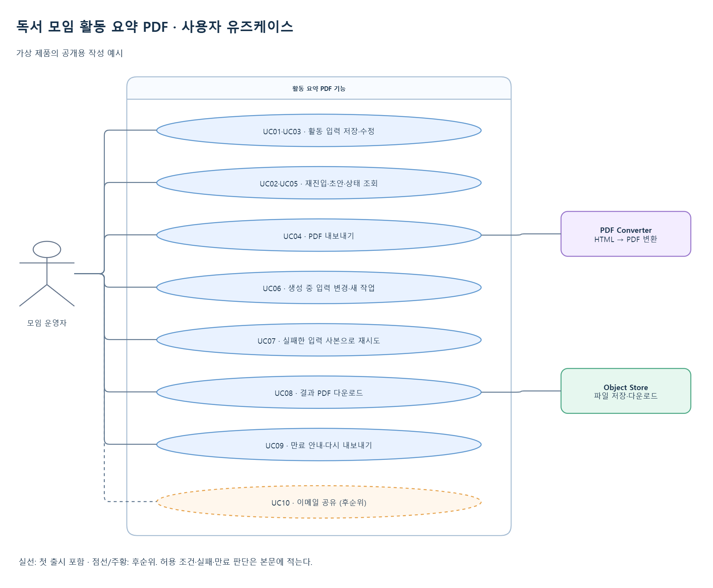
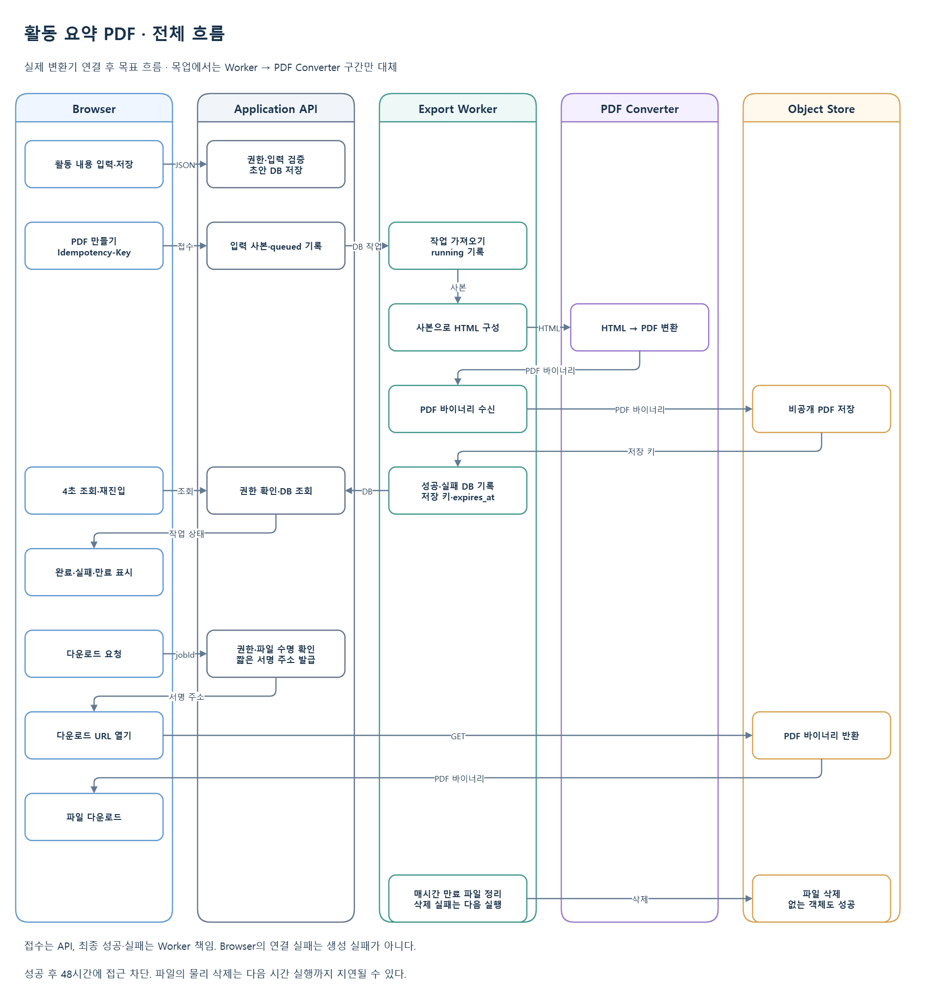
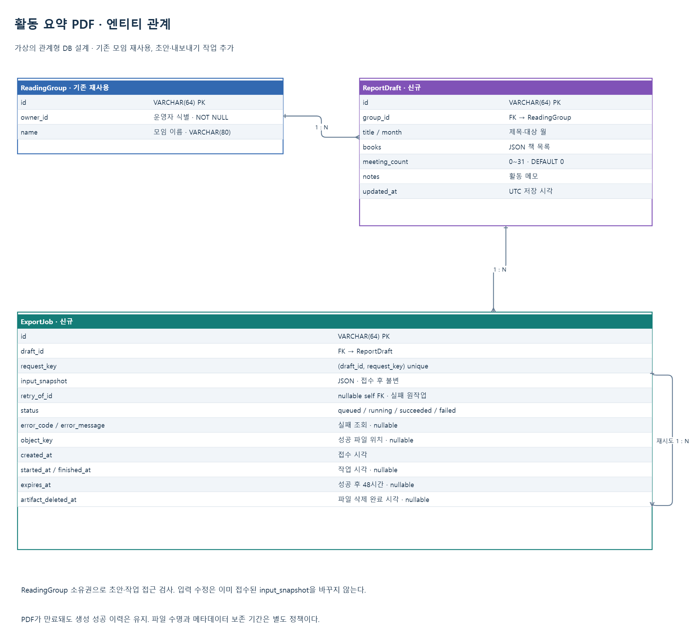

# 독서 모임 활동 요약 PDF 내보내기 · Living Spec 작성 예시

> 가상의 제품을 위한 공개용 작성 예시다. 모든 구조·계약·정책·수치는 예시용이며 실제 프로젝트의 사실을 나타내지 않는다. 문서는 기준본의 작성 형태를 보여 주고, 기능 Task와 테스트는 각각 미착수·미실행 상태다.

편집 원본: [draw.io · 유즈케이스 / 전체 흐름 / 엔티티 관계](./document-generation.drawio). [샘플 읽는 방법](./README.md).

## 1. 기능 목표·범위

독서 모임 운영자는 제목·대상 월·읽은 책·모임 횟수·활동 메모를 입력하고 구성원에게 공유할 활동 요약 PDF를 내려받는다. 페이지를 다시 열어도 작성 내용과 내보내기 결과를 확인할 수 있어야 한다.

이번 출시는 초안 저장·수정, 비동기 PDF 생성, 상태 조회, 다운로드, 실패 재시도와 파일 만료를 제공한다. 문서 업로드, 생성형 AI, 서식 편집기, 이메일 발송은 제공하지 않는다.

성공 기준은 저장한 입력으로 만든 PDF를 권한 있는 운영자가 유효기간 안에 다운로드하는 것이다. PDF 변환기 연결 전에는 고정된 테스트 PDF로 내부 흐름을 먼저 확인한다.

## 2. 사용자 Use Case



| ID | 사용자 행동과 결과 | 출시 범위 | 관련 정책 |
| --- | --- | --- | --- |
| UC01 | 사용자가 활동 내용을 입력하고 저장할 때, 모임에 연결된 초안을 저장한다. | 포함 | P01 |
| UC02 | 사용자가 초안을 다시 열 때, 저장한 입력과 내보내기 작업 목록을 보여 준다. | 포함 | P02 |
| UC03 | 사용자가 입력을 바꿀 때, 초안을 갱신한다. 이미 접수된 작업의 입력은 바꾸지 않는다. | 포함 | P03 |
| UC04 | 사용자가 PDF 만들기를 누를 때, 접수 시점의 입력 사본으로 새 작업을 만든다. | 포함 | P03·P04 |
| UC05 | 사용자가 생성 중 화면을 떠났다가 돌아올 때, 현재 작업 상태를 조회해 진행·완료·실패를 표시한다. | 포함 | P02·P05 |
| UC06 | 사용자가 생성 중 입력을 수정하거나 다른 내용으로 내보낼 때, 기존 작업은 유지하고 새 입력으로 별도 작업을 만들 수 있다. | 포함 | P03·P04 |
| UC07 | 사용자가 실패한 작업의 재시도를 누를 때, 그 작업의 입력 사본으로 새 작업을 만든다. 원래 실패 이력은 유지한다. | 포함 | P06 |
| UC08 | 사용자가 완료 결과를 누를 때, 접근 권한과 파일 유효기간을 확인한 뒤 PDF를 다운로드한다. | 포함 | P07 |
| UC09 | 사용자가 파일 만료 후 결과를 누를 때, 만료 안내와 새 내보내기 버튼을 보여 준다. 새 내보내기는 현재 초안을 사용한다. | 포함 | P08 |
| UC10 | 사용자가 이메일 전송을 원할 때, 이번 출시에서는 다운로드한 파일을 직접 공유하도록 안내한다. | 후순위 | 9절 |

## 3. 현재 구조와 제약

여러 시스템과 비동기 작업·파일 저장이 생기므로 상세 Spec으로 작성한다. 이 예시는 모임 식별자·이름·운영자 소유권을 가진 ReadingGroup이 이미 존재한다고 가정한다. ReportDraft와 ExportJob은 새로 만든다. 실제 코드·DB를 조사한 결과는 아니다.

구성요소는 Browser, Application API, Export Worker, 외부 PDF Converter, Object Store다. 기술 언어·특정 공급자는 정하지 않는다. Worker는 렌더링 요청과 파일·작업 결과를 관리하고 API는 입력·권한·접수를 담당한다.

외부 PDF Converter의 인증·한글 폰트·오류 응답은 계약 확인이 필요하다. 공급자가 준비되기 전에는 Worker가 테스트 PDF를 반환하는 목업을 사용한다. 목업에서도 내부 저장소와 다운로드 경로는 실제로 연결한다.

## 4. 결정 기록

| 항목 | 결정 상태 | 현재 결론·이유 | 바뀐 이유·영향 | 외부 의존성 |
| --- | --- | --- | --- | --- |
| D01 입력 방식 | 확정 | 정형 폼을 사용한다. 파일 파싱과 서식 편집을 추가하지 않고 내보내기 가치를 확인한다. | 최초 결정 | 없음 |
| D02 작업 소유권 | 확정 | API가 queued로 접수하고 Worker가 running·succeeded·failed를 기록한다. API 조회는 작업 결과를 변경하지 않는다. | 최초 결정 | 없음 |
| D03 진행 조회 | 확정 | Browser는 화면이 열린 동안 4초 간격으로 조회한다. 초기 규모에서는 별도 스트림 연결을 두지 않는다. | 최초 결정 | 없음 |
| D04 입력 변경 | 확정 | 초안은 자유롭게 수정하고 접수된 작업에는 입력 사본을 저장한다. 어떤 내용으로 PDF를 만들었는지 추적한다. | 최초 결정 | 없음 |
| D05 파일 수명 | 잠정 결정 | 성공 후 48시간 다운로드를 허용한다. 운영자 사용성 확인 후 재검토한다. | 기간을 바꾸면 만료 판정·정리·화면 테스트 수정 | 없음 |
| D06 PDF 변환 | 검토 중 | 실제 인증·폰트·오류 규격은 공급자 확인 후 정한다. 내부 입력과 작업 계약은 목업으로 진행한다. | 실제 변환 연계와 출시를 막으며 내부 작업은 가능 | PDF 공급자·계약 전달 시 해제 |
| D07 레이아웃 | 확정 | 제목·월·책 목록·횟수·메모를 배치한 고정 서식 하나를 제공한다. | 여러 서식 제안을 줄여 첫 출시 범위를 단순화 | 없음 |
| D08 이메일 공유 | 후순위 | 파일 다운로드까지 먼저 제공한다. 수신자·발송 실패 정책은 별도 검토한다. | UC10·9절에 반영 | 없음 |

## 5. 전체 흐름·책임



그림은 실제 PDF 변환기 연결 후의 목표 흐름이다. 목업 단계에서는 Worker→PDF Converter 호출만 고정 테스트 PDF 반환으로 대체한다.

Browser는 JSON 입력을 API에 저장한다. API는 내보내기 접수 시 초안과 모임 이름의 사본을 ExportJob에 기록한다. Worker는 작업을 가져와 사본으로 HTML을 만들고 변환기에 전달한다. 반환된 PDF 바이너리를 Object Store에 저장한 뒤 성공 상태·저장 키·만료 시각을 기록한다. Browser는 조회로 상태를 확인하고 API에서 받은 유효한 다운로드 주소를 연다.

| 책임·데이터 | 판정·생성 주체 | 저장 주체·위치 | 삭제·복구 주체 |
| --- | --- | --- | --- |
| 모임 권한·초안 | Application API | 애플리케이션 DB | 초안 보존 정책에 따라 API가 처리 |
| 내보내기 접수·입력 사본 | Application API | ExportJob | 접수 중복은 API의 requestKey로 구분 |
| 작업 성공·실패 | Export Worker | ExportJob의 상태·실패 코드 | Worker가 재시작 뒤 오래된 running을 실패 처리 |
| PDF 바이너리 | PDF Converter 생성, Worker 저장 | Object Store | Worker의 주기적 파일 정리 |
| 파일 접근 가능 여부 | API가 권한·expires_at으로 판정 | 파일의 만료 시각은 ExportJob | 실제 파일 삭제 시각과 접근 차단 시각을 구분 |

## 6. 예외·운영 정책

| 정책·상황 | 사용자 화면 | 저장 상태·이력 | 재시도·정리·담당 |
| --- | --- | --- | --- |
| P01 입력 오류 | 필드별 오류, 저장 버튼 재시도 가능 | 잘못된 입력으로 초안을 생성·수정하지 않음 | API가 제목·월·횟수·길이 검사 |
| P02 재진입·조회 단절 | 마지막 확인 상태와 연결 안내 후 다시 조회 | 서버 상태 유지. 조회 오류는 생성 실패로 저장하지 않음 | Browser가 다음 조회 시 복구. 최종 상태에서는 주기 조회 중단 |
| P03 진행 중 초안 수정 | 수정 저장과 새 내보내기 허용 | 기존 작업의 input_snapshot은 불변 | 새로 내보내면 현재 초안으로 별도 작업 생성 |
| P04 버튼 중복·접수 응답 유실 | 같은 요청은 같은 작업으로 복구 | 같은 draft_id·request_key는 작업 1개 | Browser가 논리 요청마다 새 키 사용. 응답 유실 재전송에는 기존 키 사용 |
| P05 변환 timeout·Worker 중단 | 실패 이유와 재시도 표시 | 변환 요청 45초 초과는 failed. 5분 넘은 running도 Worker 감시 작업이 failed 처리 | 늦은 완료는 failed를 덮어쓰지 않음. 저장된 고아 파일은 Worker가 정리 |
| P06 생성 실패·재시도 | 실패 설명, 동일 입력 재시도와 초안 수정 선택 | 실패 작업 유지. 재시도는 retry_of_id를 가진 새 queued 작업 | 자동 변환 재시도 없음. 같은 입력 재시도와 최신 초안 내보내기를 구분 |
| P07 다운로드 연결 실패 | 다시 다운로드 가능 | succeeded 유지 | API는 권한·파일 수명 확인 후 새 2분 유효 주소 발급 |
| P08 48시간 만료 | 결과 파일 만료 안내, 현재 초안으로 새 내보내기 | 생성 성공 이력 유지. 다운로드는 expires_at부터 410 | Worker가 매시간 정리하므로 물리 삭제는 최대 약 1시간 지연 |
| P09 파일 저장·DB 반영 실패 | 결과를 완료로 표시하지 않음 | failed와 사용자용 메시지 기록 | Worker가 임시 파일·고아 객체 삭제. 삭제 실패는 jobId·저장 키와 함께 운영 로그에 기록 |
| P10 파일 정리 실패 | 이미 만료된 파일에 접근 불가 | 삭제 성공 전 artifact_deleted_at은 NULL | 다음 시간 실행에서 재삭제. 없는 객체 삭제는 성공으로 취급 |

모든 시간은 UTC다. API는 인증된 운영자가 해당 모임을 소유하는지 검사한다. 다른 모임의 초안·작업·파일은 반환하지 않는다. 초안과 작업 메타데이터는 예시 정책으로 30일 보관한다. 작업 사본은 이력 보존 중 변경하지 않고 PDF 접근 수명과 별도로 관리한다. 본문 입력은 로그에 남기지 않으며 오류 로그는 jobId와 오류 코드로 연결한다.

## 7. API 계약

### 7.1 Browser → Application API

JSON API의 공통 prefix는 `/api`다. 인증은 예시 애플리케이션의 로그인 세션 쿠키를 사용하며 변경 요청에는 CSRF 검증을 적용한다. 초안·작업은 ReadingGroup.owner_id로 접근 권한을 확인한다.

| 동작 | method/path | 요청 | 성공 응답 | 주요 오류 |
| --- | --- | --- | --- | --- |
| 초안 생성 | POST `/api/report-drafts` | groupId·title·month·books·meetingCount·notes | 201 draftId | 400 입력, 404 접근 가능한 모임 없음 |
| 초안 조회 | GET `/api/report-drafts/{draftId}` | path ID | 200 초안·작업 목록 | 404 없음·접근 불가 |
| 초안 수정 | PATCH `/api/report-drafts/{draftId}` | 변경 필드 | 200 저장한 초안 | 400 입력, 404 없음·접근 불가 |
| 내보내기 | POST `/api/report-drafts/{draftId}/exports` | header Idempotency-Key | 202 jobId·status | 400 키 없음, 404 없음·접근 불가 |
| 상태 조회 | GET `/api/report-exports/{jobId}` | path ID | 200 상태·실패·수명·downloadAvailable | 404 없음·접근 불가 |
| 실패 재시도 | POST `/api/report-exports/{jobId}/retry` | header Idempotency-Key | 202 새 jobId·status | 409 실패한 작업 아님 |
| 다운로드 | GET `/api/report-exports/{jobId}/download` | path ID | 200 downloadUrl | 409 아직 성공 아님, 410 파일 만료 |

입력 제약은 title 필수·최대 80자, month 필수·`YYYY-MM`의 유효한 연월, books 최대 20개·각 120자, meetingCount 정수 0~31, notes 최대 2,000자다. books·meetingCount·notes를 생략하면 각각 빈 배열·0·빈 문자열을 사용한다. 초안 생성 시 groupId는 필수며 수정으로 소속 모임을 바꾸지 않는다. 사본은 이 입력과 접수 시점의 모임 이름으로 구성한다. 식별자는 최대 64자의 문자열이다. 아래 값은 모두 가상이다.

초안 생성 요청:

```json
{
  "groupId": "group-demo",
  "title": "봄 독서 활동",
  "month": "2030-04",
  "books": ["가상의 여행 이야기"],
  "meetingCount": 2,
  "notes": "인상 깊은 장면을 함께 이야기했다."
}
```

생성 응답: `{"draftId":"draft-demo"}`. 내보내기 응답: `{"jobId":"export-demo","status":"queued"}`. 같은 draftId·Idempotency-Key를 다시 보내면 처음 작업을 반환한다. 입력을 바꿔 새 결과를 원할 때는 새 키를 사용한다.

상태 응답 예시:

```json
{
  "jobId": "export-demo",
  "status": "succeeded",
  "failure": null,
  "expiresAt": "2030-04-12T10:00:00Z",
  "downloadAvailable": true
}
```

성공 전 expiresAt은 null이고 downloadAvailable은 false다. 실패 예시는 `{"jobId":"export-demo","status":"failed","failure":{"code":"RENDER_TIMEOUT","message":"PDF 변환 시간이 초과됐습니다."},"expiresAt":null,"downloadAvailable":false}`다. 생성 성공 후 파일이 만료되어도 status는 succeeded이며 downloadAvailable은 false다.

다운로드 응답은 `{"downloadUrl":"https://downloads.example.test/exports/export-demo.pdf?token=demo"}`다. 주소의 유효기간은 발급 후 2분이며 파일 자체의 expires_at을 넘지 않는다. 저장소가 바이너리를 Browser로 전송한다.

공통 API 오류 예시는 HTTP 400의 `{"error":{"code":"INVALID_INPUT","message":"제목을 입력해 주세요.","field":"title"}}`다. 404는 NOT_FOUND, 409는 EXPORT_NOT_READY 또는 RETRY_NOT_ALLOWED, 410은 EXPORT_EXPIRED를 사용한다. 실패 상태 조회는 HTTP 200이며 작업 failure로 원인을 전달한다.

### 7.2 Worker → PDF Converter · 외부 의존성

인증·실제 경로·오류 규격은 공급자와 검토 중이다. 필요한 의미는 HTML과 고정 서식 옵션을 보내 PDF 바이너리를 받는 것이다. 예시 요청은 `{"html":"<h1>봄 독서 활동</h1>","paper":"A4"}`, 성공 응답은 `Content-Type: application/pdf`의 바이너리다. 과부하·잘못된 HTML·인증 실패를 구별할 계약이 필요하다.

목업은 테스트용 고정 PDF를 반환한다. 이 JSON이나 목업 구현을 공급자의 확정 계약으로 간주하지 않는다. 실제 연계 전 한글·줄바꿈·페이지 나눔과 45초 timeout 처리를 검증한다.

### 7.3 Worker·API → Object Store

Worker가 `exports/{jobId}.pdf`에 PDF를 저장·삭제하고 API가 권한 확인 후 짧은 다운로드 주소를 발급한다. Browser는 그 주소로 파일을 받는다. 예시 저장 키는 `exports/export-demo.pdf`이며 객체는 비공개다. 업로드·서명·삭제 인터페이스는 내부 저장소 어댑터로 감싸 목업·실제 변환기 모두 같은 경로를 사용한다.

## 8. DB 계약·엔티티 재사용



ReadingGroup은 재사용하고 ReportDraft와 ExportJob을 추가하는 가상 설계다. 실제 DB 확인이나 migration 실행 결과를 뜻하지 않는다. 문자열 식별자·UTC timestamp·JSON을 지원하는 관계형 DB를 가정한다.

| 엔티티·필드 | 재사용 / 신규 | 타입·제약 | 필요한 행동·정책과 저장 이유 |
| --- | --- | --- | --- |
| ReadingGroup.id | 재사용 | VARCHAR(64) PK | 초안을 기존 모임에 연결 |
| ReadingGroup.owner_id | 재사용 | VARCHAR(64) NOT NULL | 운영자의 초안·작업 접근 검사 |
| ReadingGroup.name | 재사용 | VARCHAR(80) NOT NULL | PDF에 모임 이름 표시 |
| ReportDraft.id | 신규 | VARCHAR(64) PK | UC02 재진입할 초안 식별 |
| ReportDraft.group_id | 신규 | VARCHAR(64) FK NOT NULL | 모임 소유권과 초안 연결 |
| ReportDraft.title·month | 신규 | VARCHAR(80)·CHAR(7) NOT NULL | UC01 제목·대상 월 저장 |
| ReportDraft.books | 신규 | JSON NOT NULL DEFAULT [] | UC03 읽은 책 목록 수정 |
| ReportDraft.meeting_count | 신규 | INTEGER NOT NULL DEFAULT 0, 0~31 check | 활동 횟수 입력 |
| ReportDraft.notes | 신규 | TEXT NOT NULL DEFAULT 빈 문자열 | UC01 활동 메모 저장 |
| ReportDraft.updated_at | 신규 | UTC timestamp NOT NULL | UC02 마지막 저장 시각 표시 |
| ExportJob.id | 신규 | VARCHAR(64) PK | UC05 상태 조회·UC08 다운로드 |
| ExportJob.draft_id | 신규 | VARCHAR(64) FK NOT NULL | 초안별 작업 목록 |
| ExportJob.request_key | 신규 | VARCHAR(64) NOT NULL | P04 중복 접수 방지 |
| ExportJob.input_snapshot | 신규 | JSON NOT NULL | UC03·UC06 입력 수정과 기존 작업 분리 |
| ExportJob.retry_of_id | 신규 | VARCHAR(64) self FK NULL | UC07 원래 실패 작업과 재시도 연결 |
| ExportJob.status | 신규 | VARCHAR(16) NOT NULL DEFAULT queued | queued/running/succeeded/failed 표시 |
| ExportJob.error_code·error_message | 신규 | VARCHAR(64)·VARCHAR(240) NULL | UC07 실패 사유 재조회 |
| ExportJob.object_key | 신규 | VARCHAR(200) NULL | 성공 PDF 위치. 성공 전 NULL |
| ExportJob.created_at | 신규 | UTC timestamp NOT NULL | 작업 목록 정렬·보존 기한 |
| ExportJob.started_at·finished_at | 신규 | UTC timestamp NULL | P05 중단 탐지·성공 시각 기준 |
| ExportJob.expires_at | 신규 | UTC timestamp NULL | UC09 성공 후 48시간 접근 차단 |
| ExportJob.artifact_deleted_at | 신규 | UTC timestamp NULL | P10 파일 삭제 재시도 대상 구분 |

관계는 ReadingGroup 1:N ReportDraft, ReportDraft 1:N ExportJob, ExportJob 1:N 재시도 ExportJob이다. `(draft_id, request_key)`에 unique, `(draft_id, created_at)`에 작업 이력 인덱스, `(status, started_at)`에 중단 탐지 인덱스를 둔다. status 허용 값은 check로 제한한다. 입력 사본을 기록할 때 초안 내용을 함께 읽고 작업 접수와 사본 저장은 같은 트랜잭션으로 처리한다.

성공 파일은 48시간 뒤 접근 차단·정리한다. 작업 이력은 created_at, 초안은 updated_at부터 최소 30일 보관한다. 정리 작업은 만료된 작업 파일·참조 없는 작업 이력·참조 없는 오래된 초안 순서로 삭제한다. 재시도 작업이 참조하는 원작업은 참조가 없어질 때까지 유지한다. 모임 삭제 연계는 이번 범위에서 기존 모임 삭제 정책이 참조 초안·작업을 처리한다는 가정이며 실제 적용 전 확인한다. migration은 기존 ReadingGroup을 수정하지 않고 새 테이블·FK·인덱스를 추가한다.

## 9. 이번 출시 제외 범위

이메일 발송은 P1이다. 수신자와 재발송·실패 안내가 별도 요구사항이므로 다운로드 흐름을 먼저 제공한다. 파일 업로드, AI 요약, 여러 PDF 서식, 실시간 진행률은 제외한다. 입력 폼과 고정 서식·상태 조회로 첫 사용 가치를 확인한 뒤 수요를 재검토한다.

## 10. 작업·테스트 목록

P0은 첫 출시, P1은 후속 범위다. 예상 시간은 예시 담당자 1명의 구현과 해당 완료 기준 검증을 포함한 작업 시간이다. 외부 계약 대기는 작업량에 더하지 않는다. 선행 Task는 모두 미완료이므로 현재 가능한 항목과 선행 완료 후 가능한 항목을 구분한다.

| ID | 담당 | 우선순위 | 작업 | 선행 조건 | 예상 시간 | 착수 가능 여부 | 완료 상태 | 완료 기준 |
| --- | --- | --- | --- | --- | --- | --- | --- | --- |
| T01 | API 담당 | P0 | 초안 저장·조회·권한·DB 추가 | 가상 모임 데이터 | 4~6시간 | 지금 가능 | 미착수 | UC01~03, 다른 운영자 접근 거부 |
| T02 | Worker 담당 | P0 | 작업 접수·상태·중복 키·입력 사본 | T01 | 4~6시간 | 대기 | 미착수 | 입력 수정과 기존 작업 분리, 동일 키 중복 접수 방지 |
| T03a | Worker 담당 | P0 | 고정 PDF 목업·저장·다운로드 연결 | T02 | 3~5시간 | 대기 | 미착수 | 테스트 PDF 다운로드·권한·성공 기록 |
| T03b | Worker·외부 담당 | P0 | 실제 PDF 변환기 연결 | T03a·공급자 계약·폰트 확인 | 4~8시간 | 대기 | 미착수 | 한글·레이아웃·오류·timeout 확인 |
| T04 | 화면 담당 | P0 | 폼·저장·작업 목록·주기 조회·다운로드 | T01·T02·T03a | 6~8시간 | 대기 | 미착수 | UC01~09의 목업 화면 흐름, 최종 서식은 T03b 이후 |
| T05 | Worker 담당 | P0 | 실패·중단 탐지·수동 재시도 | T02 | 3~5시간 | 대기 | 미착수 | 실패 이력 유지·사본 재시도·늦은 결과 배제 |
| T06 | 저장소 담당 | P0 | 만료·파일 삭제·정리 실패 복구 | T03a | 3~4시간 | 대기 | 미착수 | 48시간 접근 차단·다음 정리 실행의 삭제 재시도 |
| T07 | 전 담당 | P0 | 실제 연계 E2E·migration·권한 회귀 | T03b·T04~06 | 3~5시간 | 대기 | 미착수 | V01~V08 결과와 남은 위험 기록 |
| T08 | 제품·화면 담당 | P1 | 이메일 공유 요구 검토 | 사용성 관찰·별도 범위 합의 | 추정 보류: 범위 미정 | 대기 | 미착수 | 발송·수신자·복구 정책 합의 |

T02 완료 후 T03a는 `목업으로 가능`으로 바꾼다. T03a와 공급자 계약 확인 후 T03b는 `지금 가능`으로 바꾼다. 완료 상태는 각 Task의 실제 검증 근거에 따라 별도로 갱신한다.

### 목업과 실제 연계

| 목업 Task | 실제 연계 Task | 대체 구간·전환 조건 | 목업에서 검증 가능 | 실제 연계 후 검증 |
| --- | --- | --- | --- | --- |
| T03a | T03b | Worker의 PDF Converter 호출. 공급자 계약 확정 후 실제 호출로 교체 | 입력 사본·상태 전이·Object Store 저장·테스트 PDF 다운로드·권한·만료 | 입력과 PDF 내용 일치·한글 폰트·페이지 나눔·공급자 오류·실제 변환 지연 |

목업은 실제로 열 수 있는 고정 테스트 PDF지만 사용자가 입력한 내용을 반영하지 않는다. T03a 검증이 끝나도 실제 서식 품질과 T03b·T07 완료를 뜻하지 않는다.

### 테스트 목록

| 검증 ID | 관련 행동·정책·Task | 시나리오·기대 결과 | 방법·환경 | 결과·근거 |
| --- | --- | --- | --- | --- |
| V01 | UC01~03·P01·T01 | 입력 저장·재진입·수정, 잘못된 월·제목·횟수 거부 | 자동·API | 미실행 |
| V02 | UC04·P04·T02 | 같은 키 재전송은 같은 작업, 새 키는 새 사본 | 자동·동시 요청 | 미실행 |
| V03 | UC03·UC06·T02 | 생성 중 초안 수정 후 기존 작업 사본 불변, 새 작업은 최신 입력 | 자동·Worker 목업 | 미실행 |
| V04 | UC05·P02·T04 | 화면 재진입·조회 연결 실패 후 서버 상태로 복구 | 화면·API | 미실행 |
| V05 | UC07·P05·P06·T05 | 변환 지연·Worker 중단 뒤 실패, 원래 사본으로 새 재시도 작업 | 자동·시각 제어·장애 주입 | 미실행 |
| V06 | UC08·P07·T03a/b | 테스트 파일 다운로드와 권한, 실제 변환 후 내용·한글·페이지 일치 | 목업 자동 + 실제 연계 수동 | 미실행 |
| V07 | UC09·P08~10·T06 | 48시간 경계에 다운로드 거부, 정리 실패 뒤 재삭제 | 자동·시각 제어·저장소 | 미실행 |
| V08 | 권한·보존·T07 | 다른 운영자 접근·기존 모임 기능·30일 이력 정리 영향 확인 | 자동 + migration·실제 연계 | 미실행 |

## 11. 완료 기준과 갱신

실제 작업에서는 목표·Use Case·결정·그림·계약·Task·테스트 계획 전체를 사용자가 최종 리뷰한 뒤 Spec을 완료 기준본으로 삼는다. 이 예시의 미착수·미실행 표시는 문서 작성 완료와 기능 완료가 다름을 보여 준다.

기능 출시는 P0 구현과 실제 변환기·저장소 검증·사용자 리뷰가 끝나야 완료다. D06 계약을 기다리면서 내부 목업 작업은 진행할 수 있으나 실제 연계를 완료로 표시하지 않는다.

구현 사실이 달라지면 같은 Spec의 현재 결론·변경 이유·계약·Task·검증 근거를 갱신하고 관련 draw.io 페이지와 PNG를 함께 고친다. 공통 작성 기준은 [Spec 템플릿](../../../templates/spec.md)을 따른다.
